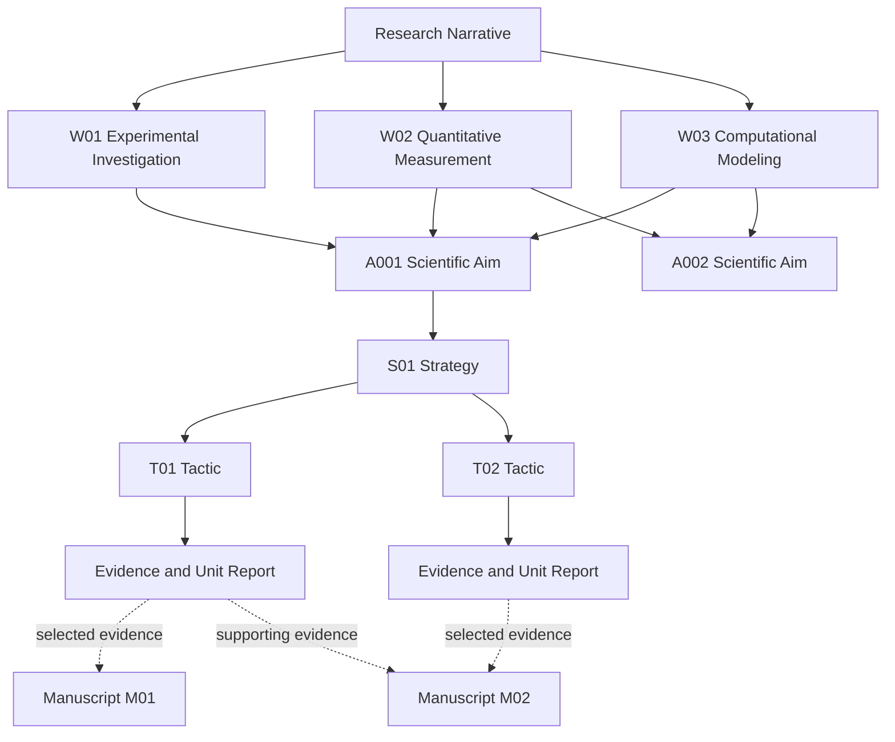

# Research Program Framework

**Version:** 1.1 (generalized life-sciences edition; design specification)  
**Date:** 2026-11-13  
**Reporting revision:** 2026-11-14 (researcher-approved scientific reporting requirements)  
**Status:** Adopted scientific specification; retained by the template-first 2.0 baseline

**Audience:** Researchers and research groups in experimental, computational, theoretical, and integrative life sciences  
**Compatibility:** Tool-agnostic; usable with human collaborators and AI coding/research agents

**Document authority:** This English specification is primary; [the Korean document](RESEARCH_PROGRAM_FRAMEWORK_v1.1_ko.md) is its companion translation. [Architecture](ARCHITECTURE.md), [file ownership and updates](OWNERSHIP_AND_UPDATES.md), and [requirements traceability](REQUIREMENTS_TRACEABILITY.md) define the development contract and distinguish adopted requirements from implemented capabilities.

> **Foundational principle:** The researcher directs the scientific program. AI agents and other supporting tools assist with critical assessment, execution within authorized boundaries, reproducibility, and documentation. They do not independently choose scientific priorities, establish claims, or determine the publication narrative.

> **Scope of examples:** Examples in this document are deliberately generic. They illustrate organizational patterns, not the datasets, methods, hypotheses, or research directions of any particular laboratory.

## 1. Purpose and design goals

The framework organizes a research program comprising several questions, experimental or computational approaches, independent units of work, evidence products, and potentially multiple manuscripts. It is intended to:

1. Preserve scientific ownership and judgment by the investigator or research team.
2. Connect broad scientific motivation to bounded, executable experimental or analytical tasks.
3. Produce scientifically complete, traceable, reusable records rather than depending on a single long chat or an individual's memory. Conciseness removes unnecessary wording, not methodological detail or evidence needed for interpretation.
4. Accommodate **wet-lab**, **dry-lab**, **theoretical**, **in vivo**, **field**, **clinical/observational**, and **hybrid** work without treating any one modality as the default.
5. Distinguish evidence collection, data processing, inference, interpretation, and manuscript construction.
6. Preserve provenance for protocols, samples, data, code, configurations, figures, and decisions.
7. Support collaboration and handoff among researchers and different AI agents while respecting access, safety, ethics, and publication requirements.
8. Keep governance lightweight: formalize what prevents errors and lost context, not every conversation or exploratory idea.

This is a **research operating framework**, not an autonomous laboratory or an automated scientific decision-maker. It complements, but does not replace, institutional records, electronic laboratory notebooks (ELNs), laboratory information management systems (LIMS), regulated data systems, or discipline-specific best practices.

## 2. Conceptual model

The framework distinguishes **scientific direction**, **organized lines of investigation**, **bounded evidence-producing work**, and **publication-specific synthesis**.

| Layer | Defining question | Typical record | Authority |
|---|---|---|---|
| **Research Narrative (N)** | What broad scientific problem motivates the program, and which explanations remain plausible? | `coordination/plans/RESEARCH_MAP.md` | Researcher/team |
| **Workstream (W)** | Which sustained line of investigation contributes evidence or capability toward that problem? | Research map; optional `workstreams/W##.md` | Researcher/team |
| **Aim (A)** | What meaningful, specific scientific question or objective is being pursued? | `coordination/plans/A###.md` | Researcher/team |
| **Strategy (S)** | What general experimental, computational, theoretical, or integrative approach could address the Aim? | Aim plan | Researcher approves |
| **Tactic (T)** | What bounded operation or analysis will produce a specific interpretable evidence package? | One research-unit report | Researcher approves |
| **Specifications** | Which protocols, inputs, controls, parameters, measurements, and acceptance criteria govern the work? | Approved unit plan; protocols/configuration | Researcher approves consequential choices |
| **Run / Experiment instance (R; optional)** | Which particular execution, experiment, batch, or acquisition yielded the evidence? | Run manifest; ELN/LIMS entry; log | Performer records; agent may assist |
| **Manuscript (M; optional)** | Which supported claims and evidence form one publication-specific argument? | `coordination/manuscripts/` | Researcher/team |

The records need not be stored in a rigid tree. The conceptual relationships are often **many-to-many**: an Aim may draw upon multiple Workstreams, a Workstream may support multiple Aims, and a Tactic may provide evidence for more than one manuscript.

### 2.1 Research Narrative

A Narrative expresses the program's broad problem, competing explanatory ideas, important unknowns, and possible relationships among findings. It is **not** a manuscript outline, a predetermined conclusion, or a set of instructions that every unit must support.

Keep these epistemic categories distinct:

- **Question:** what remains unknown.
- **Hypothesis:** a proposed explanation or prediction.
- **Observation:** what an identified source or unit actually measured.
- **Inference:** what can reasonably be concluded from the observations under stated assumptions.
- **Alternative explanation:** another account not yet excluded.
- **Synthesis:** how evidence from different sources may fit together, including disagreements.

The researcher authors and revises the Narrative. An agent may identify gaps, challenge an interpretation, or draft alternative formulations, but proposed changes remain **proposals** until explicitly accepted.

### 2.2 Workstream: an organizing unit, not a particular technology

A **Workstream** is a sustained, substantive line of investigation or capability that helps address one or more scientific questions. It can be organized around a biological scale, experimental capability, evidence source, process, or research purpose. A Workstream is **not automatically** equivalent to one instrument, assay, dataset, protocol, software repository, Aim, or manuscript.

A research team might define Workstreams by:

| Organizing basis | General life-sciences examples |
|---|---|
| **Experimental intervention** | Genetic or pharmacological perturbation; environmental manipulation; controlled exposure; organismal intervention |
| **Measurement and characterization** | Microscopy; phenotypic assays; biochemical readouts; molecular profiling; imaging; quantitative physiology |
| **Observational evidence** | Longitudinal sampling; tissue or organism collections; ecological or field observations; clinical or population datasets, subject to governance |
| **Computation and inference** | Image analysis; sequence or other high-dimensional data processing; statistical modeling; machine learning; causal-inference analysis |
| **Theory and simulation** | Mechanistic mathematical models; dynamical systems; stochastic simulation; hypothesis generation and sensitivity analysis |
| **Integration and validation** | Orthogonal assays; cross-platform comparisons; experimental validation of model predictions; multi-modal evidence synthesis |

These are **example bases for grouping**, not a mandatory taxonomy. A single Workstream may deliberately combine bench work, computational analysis, and iterative validation. Conversely, two Workstreams may use the same method for different scientific purposes.

#### Wet, dry, and hybrid Workstreams

- A **wet-lab Workstream** may include experimental design, materials and protocols, control groups, acquisition, quality control, and primary experimental evidence.
- A **dry-lab Workstream** may include computational data preparation, analysis, statistical inference, visualization, or simulation.
- A **hybrid Workstream** may link experiments, measurement, modeling, and validation in an iterative loop.
- A **theoretical Workstream** may generate formal predictions or establish limits of a model without immediately producing experimental data.

None is inherently higher or lower in the hierarchy. The distinction describes *how evidence is produced*, not who owns the scientific question or what qualifies as a Tactic.

#### Criteria for creating a Workstream

A Workstream is useful when it has a recognizable scientific purpose, a coherent set of methods or evidence, identifiable dependencies, and enough duration or scope to justify program-level visibility. Avoid creating a new Workstream for every assay, software package, dataset, or one-off test.

Record, when relevant: purpose; principal questions; included methods or data classes; inputs/resources; dependencies; linked Aims; ongoing work; limitations; and the researcher's chosen priority. Avoid recording confidential laboratory methods or identifiers in versions intended for external distribution.

### 2.3 Aim, Strategy, Tactic (AST)

The **AST hierarchy** translates scientific motivation into concrete work:

- **Aim (A):** one meaningful scientific objective, ordinarily expressible as a single sentence.
- **Strategy (S):** the general approach selected to address that Aim. One Aim may support different strategies, such as experimental intervention, observational comparison, or mechanistic modeling.
- **Tactic (T):** a bounded experimental or analytical operation, with an explicit question, specifications, and one coherent evidence package.

**The Tactic is the smallest normal reporting unit.** It may include several controls, samples, replicates, time points, calculations, or runs, provided they collectively answer the same bounded question. It need not always yield a publishable result: a well-documented negative, null, infeasible, or inconclusive outcome may still complete a useful research unit.

**A Tactic is not limited to code execution.** It may concern acquisition of an image series, a small assay, processing of observational records, fitting a model, a sensitivity analysis, or cross-validation between experimental and computational evidence. When physical or regulated work is involved, authorized humans perform that work; AI assists within its available tools and permissions.

### 2.4 Specifications and execution instances

**Specifications** translate a Tactic into reproducible instructions. Depending on modality, include:

| Wet-lab or observational work | Computational or theoretical work | Shared essentials |
|---|---|---|
| Protocol/version; sample or specimen definition; biological and technical replicates; controls; treatment/exposure; timing; randomization and blinding where relevant; instruments; calibration; acquisition settings; exclusion criteria; metadata/QC | Input data/version; software and environments; preprocessing and filters; model form; statistics; hyperparameters; seeds; simulation design; resource requirements; code revision; tests/QC | Objective; comparison; primary outcomes; acceptance criteria; planned figures/tables; uncertainties; provenance; relevant approvals |

These are candidate fields, not a requirement to fill irrelevant entries. A project's report template should ask for the **material specifications** that affect interpretation or reproducibility.

A **Run** (`R001`, `R002`, ...), if needed, identifies a concrete execution, experiment instance, acquisition, batch, or configuration. Multiple Runs may belong to one Tactic. A material change to the scientific question, design, or evaluation criteria requires renewed discussion and may warrant a new Tactic.

### 2.5 Manuscript

A **Manuscript** is a publication-specific selection and organization of claims and supporting evidence. Its scope does not define the identity of an Aim, Workstream, or Tactic.

One research program may generate several manuscripts, including a methods paper, biological discovery paper, theory paper, or resource paper. One Tactic may support multiple manuscripts or none. The researcher decides whether and how findings are combined, which claims to make, figure order, journal strategy, authorship, submission, and response to review.

## 3. Relationships: a network, not a single pipeline



This diagram illustrates possible relationships, not mandated Workstream names or a requirement that a unit be tied to a manuscript. A Workstream can mix methods. An Aim can rely on evidence from several Workstreams. The manuscript is a downstream editorial and scientific synthesis, not a parent directory of the evidence.

## 4. Identifiers and boundaries

### 4.1 Stable identifiers

The canonical Tactic/report identifier is **`A###-S##-T##`**, such as `A001-S02-T03`:

- `A###`: project-unique Aim number.
- `S##`: Strategy number local to its Aim.
- `T##`: Tactic number local to that Aim and Strategy.
- `W##`: independent Workstream identifier, associated by mapping rather than embedded in AST IDs.
- `M##` (optional): manuscript-planning identifier, independent of AST.
- `R###` (optional): execution-instance identifier nested under a Tactic.

Do not silently reuse, renumber, or recycle registered IDs. Descriptive suffixes aid reading but are not the stable identity. An existing unit should retain its ID even when its method appears in a new Workstream or its result contributes to a different paper.

### 4.2 When to create a new unit

| Change | Usual treatment |
|---|---|
| Another technical repeat or random seed | Another Run within the same Tactic |
| Another sample or batch under the same approved design | Another Run or batch within the same Tactic |
| Additional predefined control or parameter sweep for the same bounded question | Same Tactic, documenting any material change |
| Different concrete experiment/test under the same general approach | New Tactic |
| Different general approach to the same Aim | New Strategy |
| Different scientific objective | New Aim |
| New measurement modality supporting the same Aim | Add or link a Workstream as appropriate; retain Aim ID |
| Reuse of results in another manuscript | Update manuscript mapping; retain Tactic ID |

These are heuristics, not substitutes for scientific judgment. A physical experiment's practical schedule does not alone define the unit boundary; the *question and interpretable evidence* do.

## 5. Suggested project layout

The structure separates source code, results, scientific reports, materials, and program-level coordination without imposing a single repository or a single manuscript.

```text
project_root/
├── AGENTS.md                         # Shared agent working rules
├── CLAUDE.md                         # Optional tool-specific entry point
├── REPORT_TEMPLATE.md                # Shared research-unit report form
├── README.md
├── repos/
│   ├── reusable_toolkit/             # Optional independent source repository
│   └── publication_code/            # Optional independent source repository
│       ├── task_01/                  # Source code and source configurations
│       └── task_02/
├── reports/
│   └── A001-S01-T01_short_description/
│       ├── en/
│       │   ├── report.md
│       │   ├── report.html
│       │   └── report.pdf
│       └── ko/
│           ├── report.md
│           ├── report.html
│           └── report.pdf
├── analyses/
│   └── A001-S01-T01_short_description/
│       ├── results/                  # Tables, quantitative measurements, outputs
│       ├── figures/                  # Figures and export formats
│       └── logs/                     # Execution/acquisition and transfer records
├── data/                             # Project inputs and controlled datasets
├── resources/                        # Protocols, reference materials, databases
├── envs/                             # Environments and dependency records
├── notes/                            # Informal, unapproved working notes
├── docs/                             # Stable methods and technical references
│   ├── figure_style.md
│   └── compute.md                     # Optional computing/transfer conventions
├── coordination/
│   ├── plans/
│   │   ├── RESEARCH_MAP.md            # Narrative and Workstream/Aim map
│   │   ├── A001.md                    # Aim/Strategy record
│   │   └── workstreams/              # Optional expansion if needed
│   ├── manuscripts/
│   ├── revisions/
│   └── presentations/
├── templates/                        # Report-rendering templates, if used
└── tools/                            # Agent-operated helper scripts, if used
```

Existing local conventions may take precedence. **No forced migration** is implied. Physical experimental records may live in an ELN, LIMS, instrument repository, or controlled storage; the unit report should point to their authorized identifiers and locations, not copy restricted data into public directories.

### 5.1 Source of authority

| Location or system | Authoritative role |
|---|---|
| `repos/` | Maintained code, processing scripts, reusable analysis tools, and source configurations |
| `analyses/` | Per-Tactic derived outputs, figures, logs, effective configurations, run manifests |
| `reports/` | Human-readable scientific record of one Tactic |
| `coordination/plans/` | Research Narrative, Workstream relationships, Aim/Strategy plans, priorities approved by the researcher |
| `coordination/manuscripts/` | Publication-specific argument, manuscript drafts, selected figure order |
| `notes/` and `docs/` | Informal ideas versus stable operating references |
| ELN/LIMS/instrument/controlled archives | Primary experimental records, sample provenance, instrument acquisitions, regulated or restricted materials where applicable |
| `data/`, `resources/`, `envs/` | Inputs, dependencies, and supporting resources subject to local access policies |

An evidence package may depend on several repositories, instruments, protocols, or data sources. The report links them; it does not attempt to duplicate all sources or treat one copied folder as authoritative for everything.

## 6. Program-level planning

### 6.1 `RESEARCH_MAP.md`

The Research Map is a concise index of the **researcher-authored program**, not a comprehensive notebook or auto-generated backlog. It should record:

1. A central question or set of linked broad questions and current narrative, distinguishing provisional ideas from established findings.
2. Competing hypotheses and unresolved alternatives.
3. Workstreams, why each exists, which methods/evidence it may use, and what limitations apply.
4. Registered Aims and their relationships to one or more Workstreams.
5. Important cross-Workstream integration questions and evidence gaps.
6. Researcher-selected priorities, dependencies, and paused or proposed directions.
7. Links to Aim plans, unit reports, and manuscript plans.
8. A dated record of substantive researcher-approved strategic revisions.

A Workstream registry can be as simple as:

| Workstream | Purpose | Methods/evidence (illustrative) | Related Aims |
|---|---|---|---|
| W01: Experimental investigation | Test a defined intervention or causal contrast | Controlled perturbations, controls, quantitative assays | A001, A003 |
| W02: Observation and measurement | Quantify a phenotype at relevant scales | Imaging, biochemical readouts, longitudinal acquisition | A001, A002 |
| W03: Modeling and inference | Formalize predictions and evaluate evidence | Statistics, mathematical modeling, simulation | A002, A003 |
| W04: Integration and validation | Compare independent lines of evidence | Orthogonal assays, cross-method replication | A003 |

**These names are illustrative only.** A laboratory may use entirely different divisions, organize by biological theme rather than technique, or combine all four modes within one Workstream.

### 6.2 Aim plans

An `A###.md` file may summarize an Aim, motivation, candidate and approved Strategies, linked Workstreams, Tactic statuses, relevant reports, and major unresolved questions. It need not repeat each experimental protocol, full analysis configuration, or figure.

### 6.3 Manuscript planning

Manuscript planning is intentionally separate:

- **Research Narrative:** the program's evolving scientific questions and explanatory possibilities.
- **Workstream:** a sustained line of investigation or evidence production.
- **Manuscript Narrative:** the selected, evidence-backed argument for one publication or communication.

Separate manuscripts may focus on mechanism, methods, quantitative theory, validation, or resource development. Their scopes may be revised, combined, or separated by researcher decision without changing AST IDs.

### 6.4 Strategic change control

Changing a central hypothesis, Workstream scope, Aim, major priority, or manuscript argument is a **scientific direction decision**. Agents may identify contradictions and propose options, but must not silently revise approved direction or treat an unreviewed hypothesis as established. Once the researcher approves a change, an agent may update the record with the date, rationale, affected links, and remaining uncertainties.

## 7. Roles, authorization, and accountability

| Activity | Researcher or authorized lab personnel | AI agent |
|---|---|---|
| Choose the broad questions and narrative | **Decides** | Clarifies, critiques, suggests alternatives |
| Define and prioritize Workstreams | **Decides** | Maps evidence and dependencies |
| Define or materially revise Aims/Strategies/Tactics | **Approves** | Drafts options and feasibility checks |
| Approve scientifically consequential specifications | **Approves** | Drafts and validates consistency |
| Perform physical experiments, sample handling, animal/human-subject activities, instrument operation | **Performs according to authorization, training, and oversight** | May help plan and document; no implied physical autonomy |
| Write analysis software, tests, configurations, and report generators | Reviews as needed | **Performs when authorized** |
| Perform local computational analysis | Delegates | **Performs within granted permissions** |
| Run external HPC, institutional systems, or sensitive actions | **Performs or explicitly authorizes** | Prepares commands and interprets verified returns if direct access is unavailable |
| Assign IDs and organize local files | Approves scope | **Performs routine administration** |
| Record experiment/run provenance and output references | Ensures primary records are accurate | Assists with structured records and checks |
| Create scientifically complete reports and figures | Interprets and reviews | Drafts and renders when technically possible |
| Interpret evidence and formulate scientific claims | **Decides** | Critically evaluates evidence and caveats |
| Construct manuscript argument and publication decisions | **Decides** | Organizes and drafts on request |
| Publish, push, delete important resources, disclose protected data | **Separately authorizes** | Acts only within explicit permissions |

**Do not confuse helping with research design with assuming authority for research decisions.** Agents should actively surface missing controls, alternative explanations, and potential errors; they should not autonomously redirect the program.

### 7.1 Ethics, safety, and protected data

The framework does not waive discipline-specific oversight. Relevant animal, human-participant, clinical, biosafety, chemical safety, data protection, and institutional requirements must be addressed through authorized procedures. Primary records and sensitive data should remain in approved systems. Summaries and reports should contain only information authorized for their audience. A shared framework document must never disclose a laboratory's actual research plan by accident.

## 8. Chat-first workflow and human handoffs

The normal user interface may be a project-root session in a coding assistant, an IDE, or another suitable tool. The researcher should not have to remember folder-creation commands, report-generation commands, or internal ID-allocation scripts.

### 8.1 Coordination: program-level planning conversation

Discuss Narrative, Workstreams, Aims, or manuscripts. The agent can read prior reports, identify gaps, and draft alternatives. **Do not create an AST unit solely because a planning discussion occurred.** Strategic changes are saved as adopted decisions only after researcher confirmation.

Coordination and AST sessions communicate through persistent project files, not
direct chat access. No mandatory cross-session message, summary document or
automatic chat handoff is required. An AST may revise its report repeatedly; a new
AST is needed only for a substantively distinct evidence-producing task.

### 8.2 First unit in a new program

Inspect the project's existing records. If no registered Aim or Tactic exists, collaboratively define the first Aim, Strategy, Tactic, and Specifications, normally assigning `A001-S01-T01` after approval. Prepare the folders and artifacts automatically, subject to actual permissions.

### 8.3 Follow-up unit

Read only the relevant Research Map sections, Aim plans, existing reports, and referenced source materials. Decide with the researcher whether the new question uses the same Aim/Strategy or requires a new one. Allocate a unique ID, obtain approval, and conduct the bounded task.

### 8.4 Resume interrupted work

For unfinished computation, pending experimental acquisition, processing, or data transfer, inspect the approved plan, unit status, experiment/run identifiers, logs, and available records. Resume the **same Tactic ID** rather than allocating a new one. Identify which work is verified and which evidence is still missing.

### 8.5 Review and synthesis without starting another unit

The researcher can request criticism, comparison, literature assessment, design discussion, or a manuscript-level synthesis without initiating implementation. The agent should not manufacture a new Tactic merely to make the workflow uniform.

## 9. Research-unit lifecycle

### Phase I: collaborative planning

Capture a shared, approved plan:

1. **Motivation:** Which earlier observation, theory, limitation, or unresolved issue makes the work necessary?
2. **Aim:** What larger specific question does it address? State in one sentence.
3. **Strategy:** What broad method or evidentiary approach will be used, why was it selected, and which consequential assumptions apply?
4. **Tactic and Methods:** What bounded experiment, acquisition, test, model, or analysis will now be performed? State the Tactic question in one sentence, then explain the proposed units, measurements, procedures, calculations, comparisons, uncertainty, and figure construction in sufficient scientific detail.
5. **Specifications:** Which exact material inputs, samples, conditions, controls, parameters, thresholds, replicates, protocols, outcomes, analyses, QC criteria, and evidence products are required? Keep planned settings distinct from source defaults and verified effective settings.

Scientific approval is required before materially consequential implementation. The plan remains an explicit reference; deviations affecting interpretation require explanation and appropriate renewed approval.

### Phase II: execution and evidence capture

- **Wet/field/clinical:** Qualified people carry out authorized activities; capture protocol versions, sample IDs, collection conditions, experimental batches, instrument or source records, deviations, and metadata in the established systems.
- **Dry/theoretical:** Agents or researchers develop code/model definitions, run permitted computations, maintain tests and configurations, and record software versions, data provenance, seeds, and exact execution parameters.
- **Hybrid:** Track handoffs between physical experimentation, data acquisition, preprocessing, modeling, and experimental validation; preserve each modality's provenance without conflating them.
- **External or restricted systems:** An agent must not invent access or bypass safeguards. Where the working policy uses human-operated remote execution, the human runs commands while the agent prepares exact, safe instructions and checks returned evidence.
- **Outputs:** Store derived results under the correct unit folder when permitted, or cite controlled archival locations with system/host identifiers and stable accession or record IDs.

The unit status can be `WAITING` or `BLOCKED` while evidence is incomplete. A new conversation should be able to recover the actual state from durable records.

### Phase III: verification and reporting

- Confirm that experimental or computational evidence exists, has the asserted origin, and corresponds to the approved specifications.
- Verify critical QC, controls, sample/execution identity, and any exclusions or deviations.
- Center the report on one main figure or coherent evidence set; use a table where a figure would not faithfully represent the result.
- Separate **Results (observations)** from **Interpretation (inferences)**.
- State uncertainty, limitations, possible confounding, and alternative explanations.
- Link protocols/records, code, inputs, effective settings, outputs, figures, and relevant versions. Keep large raw tables, complete logs, and code in linked artifacts while retaining the material scientific explanation in the report.
- Prepare the agreed language and document formats, then stop. New work requires a new scientific instruction or approval.

**Completion does not imply a hypothesis was supported.** A properly executed study with negative, null, or inconclusive evidence is still informative.

## 10. Research-unit report contract

The default paired language/output format retained from v1.0 is:

```text
reports/<A###-S##-T##_slug>/
├── en/
│   ├── report.md
│   ├── report.html
│   └── report.pdf
└── ko/
    ├── report.md
    ├── report.html
    └── report.pdf
```

Markdown is the editable source for each language; HTML and PDF are renderings. English and Korean versions must preserve the same scientific definitions, equations, procedures, parameters, units, replication, findings, claims, figure or table references, and source attribution.

**There is no report page-count target, minimum, or maximum.** Scientific completeness and readability determine length. Do not omit methods, shrink typography or figures, or force equal English and Korean page counts to satisfy a length expectation. Page counts are recorded for inspection only and must not determine build success or scientific acceptance. A brief summary may accompany the report but does not replace its scientific account.

The report must let a scientifically trained collaborator or advisor understand what was done, why, how quantities and figures were derived, and what the findings support without opening the source code. Its methodological detail should support manuscript preparation. Large raw tables, complete logs, and code remain in linked artifacts; links and execution logistics do not replace Methods.

The report contract has eleven corresponding sections:

1. **Motivation:** Scientific rationale, relevant prior evidence, and the unresolved question.
2. **Aim and Tactic Question:** The Aim and bounded Tactic question, each in one sentence, with the scope of inference.
3. **Strategy:** The scientific approach, why it was selected, and consequential assumptions.
4. **Tactic and Methods:** The actual experimental, computational, observational, theoretical, or hybrid procedures in scientific order; proposed procedures remain clearly labeled during planning.
5. **Specifications:** Exact inputs, sample definitions, conditions, settings, thresholds, replication, metrics, QC, and evaluation criteria, with their verification status.
6. **Execution and Validation:** What actually occurred, where and when, output and control checks, deviations, and validation limits.
7. **Figures or Primary Evidence:** A coherent evidence set, using figures or primary evidence tables as appropriate, with complete legends and construction details.
8. **Results:** Verified observations and numerical findings, denominators and uncertainty where applicable, linked to supporting artifacts; include negative and null findings.
9. **Analysis and Interpretation:** The answer supported by the evidence, inferential assumptions, competing explanations, and the distinction between descriptive, predictive, and causal claims.
10. **Limitations and Next Questions:** Methodological and sampling limitations, missing evidence, and optional follow-up questions without initiating new work.
11. **Reproducibility and Artifact References:** Primary records, sources, inputs, effective settings, outputs, figures, validation, and known versions or explicit provenance gaps.

The project's `REPORT_TEMPLATE.md` defines exact local presentation and rendering while retaining this reporting contract. Modality-specific subsections may vary; material information must not be omitted and irrelevant fields need not be fabricated.

### 10.1 Figure and typography defaults

For publication-oriented figures, retain the configurable v1.0 defaults:

- PNG: **600 dpi** at intended physical size.
- PDF: vector output where feasible.
- SVG: vector/editable output where feasible.
- Figure lettering: **Arial, 5–7 pt** at final displayed size.
- Non-data-encoded figure text: solid black (`#000000`). Color may be used to encode data categories.
- Reports: prefer **Noto Serif** for English and **Noto Serif KR/CJK KR** for Korean PDF/HTML output.

Treat these as **project style defaults**, not universal journal or accessibility rules. Journal requirements, display legibility, actual font installation, and measurement-image integrity override them where necessary. Do not fabricate vector fidelity by converting raster-only experimental images to SVG; label embedded raster components appropriately.

### 10.2 Status and outcome are separate

**Operational status:** `PLANNING`, `APPROVED`, `EXECUTING`, `WAITING`, `BLOCKED`, `FAILED`, `COMPLETED`.

**Scientific outcome (when applicable):** `NOT_EVALUATED`, `SUPPORTED`, `NOT_SUPPORTED`, `INCONCLUSIVE`.

An operationally completed unit may reach an inconclusive scientific outcome. Status does not indicate whether a hypothesis was confirmed.

Where no hypothesis or scientific outcome was evaluated, a completed descriptive or technical unit may retain `NOT_EVALUATED` with an explicit explanation. Do not manufacture a hypothesis verdict to pass a report validator. This does not excuse unperformed work or missing evidence required by the approved Tactic.

### 10.3 Required methodological coverage

Describe the applicable material details precisely:

- Scientific rationale, methodological strategy, and consequential assumptions.
- Samples, specimens, observations, measurements, variables, denominators, units, and the distinction between observational units and independent biological or other replication.
- Inclusion and exclusion criteria, group assignment, missing observations, filters, preprocessing, normalization, transformations, and their procedural order.
- Actual interventions, acquisition, experimental or computational procedures, theoretical definitions and derivations, and relevant protocol or instrument settings.
- Mathematical and statistical calculations, with notation defined beside equations, model form, comparison or control rationale, dependence, uncertainty estimation, resampling, testing, multiplicity, and decision criteria when used.
- Exact parameters, operational specifications, sensitivity variants, validation and QC criteria, and scientifically material deviations from the approved plan.
- Figure and table construction: the mapping from measurements or calculations to panels, axes, units, scales, normalization, colors, markers, lines, thresholds, exclusions, and uncertainty displays.
- Results, supported interpretation, limitations, possible confounding, alternatives, and the provenance needed to reconstruct the work.

For experimental work, explain protocols, controls, biological and technical replication, batches, acquisition, and authorized primary-record references. For observational work, explain sampling, exposure and outcome definitions, confounding, and missingness where relevant. For theoretical work, explain assumptions, definitions, equations or derivations, and conditions of validity. Hybrid work preserves the links and provenance across its component methods. If a test, uncertainty estimate, or control was not used, state that and its implications rather than implying it was performed.

### 10.4 Actual procedures and provenance boundaries

Distinguish planned settings, source defaults, methods reconstructed from available source or documentation, verified effective settings and procedures, and unknown execution history. An available repository HEAD is not automatically the producing revision. Record relevant source hashes and working-tree modifications when an executed source is not fully identified by a clean commit. Do not label reconstructed methods or consistency checks as a reproduction of an unverified historical run.

Explain established methods even when historical execution metadata are missing, and state gaps precisely. A reporting revision preserves approved plans and earlier report revisions; it does not authorize new analyses, changed statistics, a provenance investigation, or bulk report regeneration outside the requested scope. Report revision identifiers and optional execution Run identifiers have distinct roles and must not be conflated.

### 10.5 Verification and bilingual rendering

The agent checks structure, unresolved placeholders, metadata, available references, equations, numerical tables, evidence exports, and matching English and Korean parameters and findings. Automated checks cannot establish methodological adequacy, statistical correctness, semantic equivalence, or researcher adoption of a claim. Review those explicitly and visually inspect HTML and PDF figures, equations, glyphs, fonts, captions, tables, and pagination.

Unsupported mathematics, missing required assets, or unavailable fonts must be reported explicitly; never silently omit content or claim an unverified final rendering. Treat font substitution as a disclosed preview unless an appropriate project style change is approved. A successful render alone does not complete scientific validation. Generate the paired outputs, preserve prior revisions when replacing reports, present the verified findings, and stop within the approved scope.

## 11. Provenance, portability, and reproducibility

A report should make it possible to reconstruct **what was intended, what actually occurred, and which evidence supports the stated conclusion**. Record only what is applicable, but verify it.

| Provenance class | Examples |
|---|---|
| Scientific identity | AST ID, related Workstream/Aim, approved question, approved and revised specifications |
| Experimental records | Protocol identifier/version, sample/source ID, batch, controls, replicates, instrument/acquisition record, ELN/LIMS accession, relevant approvals |
| Computational records | Source repository, relative and verified absolute paths, commit hash, environment, command, parameters, seeds, tests |
| Inputs and outputs | Input dataset or specimen reference, derived measurements, tables, model outputs, figures, logs, checksums/accessions where justified |
| Interpretation | Primary result, assumptions, uncertainty, exclusions, caveats, unresolved alternatives |

Use **system-qualified paths** where possible (machine/host plus absolute path) and stable accession or record identifiers when available. A path alone does not guarantee an immutable version. Do not copy restricted human data, unpublished confidential protocols, or raw instrument datasets into public source repositories by default.

Code published from `repos/` should remain independently usable with documented inputs. Outputs under `analyses/` and scientific reports under `reports/` may reference it without duplicating editable source trees.

## 12. Multiple agents and collaborator continuity

The framework's scientific records are **tool-agnostic**. Assistants and collaborators may have different local context, memories, skills, permission models, and execution tools. No authoritative research fact should exist only in proprietary chat history or implicit model memory.

| Entry point | Purpose |
|---|---|
| `AGENTS.md` | Shared operating rules and decision boundaries for compatible agents |
| `CLAUDE.md` | Optional Claude-specific entry point |
| `REPORT_TEMPLATE.md` | Standard unit report format |
| `coordination/plans/RESEARCH_MAP.md` | Approved broad narrative and Workstream/Aim mapping |
| `coordination/plans/A###.md` | Aim/Strategy record and links to Tactics |
| `docs/` | Local policies for figures, computing, experimental record conventions, and methods |
| `tools/` | Agent-operated helper scripts, not commands the researcher must memorize |

Human collaborators can use the same records without any AI tool. An agent's useful role is to prepare the paperwork, check the consistency and provenance, and point out information gaps, not to make the researcher manually administer the folder hierarchy.

## 13. Minimal governance and change control

Maintain a practical separation of responsibility:

- **Researcher-controlled:** broad Narrative, Workstream definitions and priorities, consequential Aim/Strategy/Tactic decisions, scientific interpretation adopted as a claim, manuscript structure and publication decisions.
- **Agent-managed when authorized:** routine unit creation, naming, source changes within the approved scope, eligible local calculations, output organization, report rendering, and status/provenance bookkeeping.
- **Human- or institution-controlled:** physical experiments, sensitive instrument operation, restricted data access, regulated activities, external computing requiring authentication, and publication or destructive actions without granted authority.
- **No automatic scope expansion:** finding a promising result does not authorize a new project, experiment, analysis, Workstream, or manuscript.
- **Transparent uncertainty:** an unperformed task or unverifiable result must be labeled as such, not inferred to have succeeded.

Proposals may be vigorous and critical; adoption is deliberate and documented.

## 14. Illustrative applications in life sciences

The examples below are **synthetic demonstrations**, not descriptions of any laboratory's current work.

### Example A: Primarily experimental

- **Broad question:** How does a controllable intervention affect an observable biological phenotype?
- **Possible Workstreams:** intervention design; quantitative phenotyping; independent validation.
- **Aim `A001`:** Estimate whether intervention X changes phenotype Y under predefined conditions.
- **Strategy `S01`:** Conduct a controlled comparison with appropriate biological replication.
- **Tactic `T01`:** Measure a prespecified endpoint and estimate its difference with uncertainty.
- **Specifications:** sample inclusion, controls, timing, replicate definitions, acquisition parameters, primary endpoint, QC, and analysis plan.
- **Evidence:** measurement table, QC log, one primary figure, protocol record and sample provenance.

### Example B: Primarily computational

- **Broad question:** Can a quantitative model explain or predict a measured biological response?
- **Possible Workstreams:** curated observational evidence; statistical inference; mechanistic simulation.
- **Aim `A002`:** Compare the predictive performance of candidate models on held-out observations.
- **Strategy `S01`:** Establish predefined validation splits and performance metrics.
- **Tactic `T01`:** Evaluate baseline model performance and uncertainty under the approved data partition.
- **Specifications:** data versions, exclusion rules, split design, parameterization, seed, metrics, model revision, and validation tests.
- **Evidence:** metrics table, comparison figure, reproducible code, environment, and run records.

### Example C: Integrated wet/dry research

- **Broad question:** Does a mechanistic prediction remain consistent with independent biological measurements?
- **Possible Workstreams:** hypothesis-driven experimental perturbation; data processing and modeling; orthogonal verification.
- **Aim `A003`:** Determine whether two independent evidence types support the same proposed relationship.
- **Strategy `S01`:** Define one quantitative prediction and a complementary measurement procedure.
- **Tactic `T01`:** Evaluate the prediction against the predefined evidence and QC criteria.
- **Specifications:** acquisition protocol and batch metadata, data linkage rules, model settings, decision criteria, control checks, and outcome uncertainty.
- **Evidence:** linked acquisition records, analysis outputs, a consolidated figure, and an explicit statement of concordance or disagreement.

The same AST and scientifically complete reporting contract applies in all three examples, even though who performs the physical steps, what must be logged, and which source systems are authoritative differ.

## 15. Version history and implementation status

| Version | Scope |
|---|---|
| **v0.5** | Initial multi-agent starter: shared instructions, AST-centered computational workflow, concise bilingual reports, figure exports, and local/HPC file handoffs. |
| **v1.0** | Research program design: human-owned Narrative, Workstream mapping, AST unit identity, manuscript separation, program-level decision rights. |
| **v1.1 (this document)** | **Generalizes Workstreams and evidence production across life sciences:** experimental, computational, theoretical, observational, and integrated methodologies; removes laboratory-specific illustrations; recognizes primary experimental records and authorization boundaries. |

**Implementation baseline:** Release 2.0 retains this scientific design and the
2026-11-14 detailed reporting revision. Its template-first architecture supersedes
the earlier installation, compatibility and phase-by-phase development design.
No automatic conversion of existing projects or historical research is required.
See [architecture](ARCHITECTURE.md) and [requirements traceability](REQUIREMENTS_TRACEABILITY.md).

### Adoption without restructuring

1. Retain existing repositories, output folders, templates, and AST IDs.
2. Use `coordination/plans/RESEARCH_MAP.md` to record researcher-approved Narrative/Workstream/Aim relationships when the team is ready.
3. Add or revise only the smallest common agent instruction needed to consult that map without autonomously modifying it.
4. Record physical or observational provenance in the appropriate primary system and link it from the Tactic report.
5. Pilot an experimental, computational, and integrated unit, including at least one interrupted or deferred handoff, before widening automation.

## 16. Success criteria

The framework succeeds when:

- A researcher can discuss broad program direction **without** being forced into a new AST unit.
- The same AST identity and scientifically complete reporting standard work for wet, dry, theoretical, observational, and hybrid evidence.
- Workstreams are flexible scientific organizing units, not an index of proprietary assays or a laboratory's specific research topics.
- Every reported finding has traceable source records and can be critically examined without the original conversation.
- Different collaborators or AI agents can resume appropriately authorized work using saved records rather than reconstructed memory.
- A completed experimental or computational unit does not automatically alter research priorities or initiate follow-up work.
- The researcher retains control of interpretation, narrative synthesis, and manuscript decisions while routine administration and technical work become less burdensome.

---

**In one sentence:** Researchers design the scientific program; Workstreams organize complementary lines of biological evidence; AST units produce bounded, traceable findings; and researchers assemble those findings into evolving scientific explanations and manuscripts, with AI serving as a critical and operational assistant.
