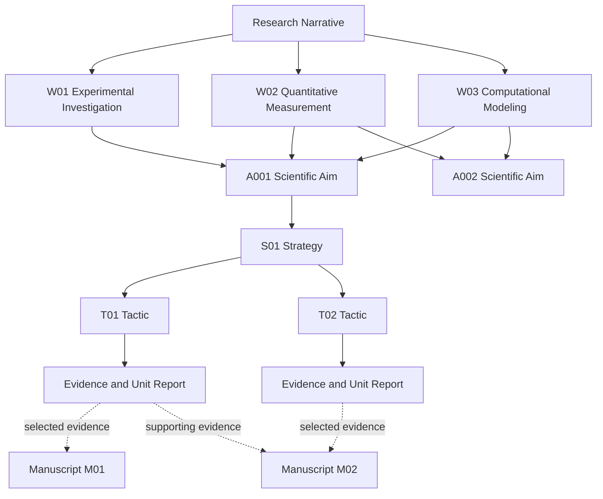

# 연구 프로그램 운영 프레임워크

**버전:** 1.1 (생명과학 전반에 적용할 수 있도록 일반화한 설계 명세)  
**날짜:** 2026-11-13  
**보고 규약 개정:** 2026-11-14 (연구자가 승인한 과학적 보고 요구사항)  
**상태:** 채택된 설계 명세. 구현은 승인된 단계에 한해서 진행  
**대상:** 실험, 계산, 이론, 통합 생명과학 분야의 연구자 및 연구 그룹  
**호환성:** 특정 도구에 종속되지 않으며, 사람 사이의 협업과 AI 코딩·연구 에이전트를 모두 지원

**문서의 기준:** [영문 명세](RESEARCH_PROGRAM_FRAMEWORK_v1.1.md)가 우선 기준이며, 이 문서는 대응하는 한국어 번역이다. [아키텍처](ARCHITECTURE.md), [파일 소유권과 업데이트](OWNERSHIP_AND_UPDATES.md), [요구사항 추적표](REQUIREMENTS_TRACEABILITY.md)는 개발 규약을 정의하고 채택된 요구사항과 구현된 기능을 구분한다.

> **기본 원칙:** 연구 프로그램의 방향은 연구자가 결정한다. AI 에이전트와 기타 보조 도구는 비판적 검토, 승인된 범위 내 실행, 재현성 확보, 문서화를 지원한다. 과학적 우선순위를 독자적으로 결정하거나, 과학적 주장을 확정하거나, 논문의 내러티브를 대신 결정하지 않는다.

> **예시의 범위:** 이 문서의 예시는 의도적으로 일반화되어 있다. 특정 연구실의 데이터, 연구 방법, 가설 또는 연구 방향을 설명하는 것이 아니라 연구를 조직하는 방식을 보여주기 위한 것이다.

## 1. 목적과 설계 목표

이 프레임워크는 여러 과학적 질문, 실험적·계산적 접근법, 독립적인 작업 단위, 증거 산출물, 그리고 잠재적으로 여러 편의 논문으로 구성된 연구 프로그램을 조직한다. 다음을 목표로 한다.

1. 연구자 또는 연구팀의 과학적 주도권과 판단을 보존한다.
2. 큰 과학적 동기를 실제 수행 가능한 제한된 범위의 실험·분석 작업으로 연결한다.
3. 하나의 긴 채팅이나 개인의 기억에 의존하는 대신, 과학적으로 완결되고 추적 가능하며 재사용할 수 있는 기록을 남긴다. 간결함은 불필요한 표현을 줄이는 것이며, 방법론적 상세나 해석에 필요한 증거를 생략하는 것이 아니다.
4. 특정 방식을 기본값으로 전제하지 않고 **실험실 연구(wet-lab)**, **계산 연구(dry-lab)**, **이론 연구**, **생체 내 연구(in vivo)**, **현장 연구(field)**, **임상·관찰 연구**, **혼합 연구(hybrid)**를 모두 수용한다.
5. 증거 수집, 데이터 처리, 추론, 해석, 논문 구성을 구분한다.
6. 프로토콜, 시료, 데이터, 코드, 설정, 그림, 의사결정의 출처와 이력을 추적할 수 있게 한다.
7. 접근 권한, 안전, 윤리, 출판 요건을 준수하면서 연구자 및 서로 다른 AI 에이전트 사이의 협업과 업무 인계를 지원한다.
8. 관리 부담을 가볍게 유지한다. 모든 대화나 탐색적 아이디어를 형식화하는 대신, 오류와 맥락 손실을 방지하는 데 필요한 부분을 체계화한다.

이것은 **연구 운영 프레임워크**이지, 자율적으로 연구실을 운영하는 시스템이나 과학적 의사결정 자동화 장치가 아니다. 기관의 공식 기록, 전자연구노트(ELN), 실험실 정보 관리 시스템(LIMS), 규제 대상 데이터 시스템 또는 분야별 모범 실무를 대체하지 않고 보완한다.

## 2. 개념적 모델

프레임워크는 **과학적 방향**, **조직화된 연구 축**, **명확한 범위에서 증거를 생산하는 작업**, **출판에 특화된 종합**을 구분한다.

| 계층 | 핵심 질문 | 대표적인 기록 | 결정 권한 |
|---|---|---|---|
| **Research Narrative (N), 연구 내러티브** | 프로그램을 움직이는 큰 과학적 문제는 무엇이며 어떤 설명들이 여전히 가능한가? | `coordination/plans/RESEARCH_MAP.md` | 연구자·연구팀 |
| **Workstream (W), 연구 축** | 그 문제에 증거나 연구 역량을 제공하는 지속적인 연구 활동의 축은 무엇인가? | 연구 지도, 선택적 `workstreams/W##.md` | 연구자·연구팀 |
| **Aim (A), 연구 목표** | 어떤 구체적이고 과학적으로 의미 있는 질문이나 목표를 다루는가? | `coordination/plans/A###.md` | 연구자·연구팀 |
| **Strategy (S), 전략** | 해당 Aim에 답하기 위한 전반적인 실험·계산·이론·통합 접근법은 무엇인가? | Aim 계획서 | 연구자 승인 |
| **Tactic (T), 전술적 작업** | 해석 가능한 특정 증거 묶음을 생산할 제한된 범위의 작업이나 분석은 무엇인가? | 작업 단위 보고서 한 편 | 연구자 승인 |
| **Specifications, 실행 명세** | 어떤 프로토콜, 입력, 대조군, 파라미터, 측정값, 판정 기준으로 작업을 수행하는가? | 승인된 작업 계획, 프로토콜·설정 파일 | 과학적으로 중요한 선택은 연구자 승인 |
| **Run / Experiment instance (R), 개별 실행·실험** | 어느 실행, 실험, 배치 또는 데이터 획득 과정에서 증거가 생성되었는가? | 실행 명세서, ELN/LIMS 기록, 로그 | 수행자가 기록하고 AI가 지원 가능 |
| **Manuscript (M), 논문** | 어떤 근거 있는 주장과 증거를 모아 하나의 출판 논증을 구성하는가? | `coordination/manuscripts/` | 연구자·연구팀 |

이 기록들이 반드시 엄격한 트리 구조로 저장될 필요는 없다. 개념적 관계는 대개 **다대다(many-to-many)**이다. 하나의 Aim이 여러 Workstream의 증거를 사용할 수도 있고, 하나의 Workstream이 여러 Aim을 지원할 수도 있으며, 하나의 Tactic이 여러 논문에 근거를 제공할 수도 있다.

### 2.1 Research Narrative: 연구 내러티브

연구 내러티브는 프로그램의 큰 문제, 경쟁하는 설명, 중요한 미지의 사항, 결과 사이의 가능한 관계를 표현한다. **논문 목차도, 미리 정해 놓은 결론도, 모든 작업이 뒷받침해야만 하는 지침도 아니다.**

다음과 같은 인식론적 범주를 구분한다.

- **질문(Question):** 아직 알려지지 않은 것.
- **가설(Hypothesis):** 제안된 설명이나 예측.
- **관측(Observation):** 출처가 확인된 자료 또는 작업 단위에서 실제로 측정된 것.
- **추론(Inference):** 명시한 가정 아래에서 관측으로부터 합리적으로 도출할 수 있는 것.
- **대안적 설명(Alternative explanation):** 아직 배제되지 않은 다른 설명.
- **종합(Synthesis):** 서로 다른 출처의 증거가 어떻게 연결될 수 있는지, 또는 어디서 서로 충돌하는지에 대한 설명.

연구자는 내러티브를 작성하고 수정한다. AI는 빠진 부분을 지적하거나 해석을 비판하거나 다른 표현을 제안할 수 있다. 그러나 변경 제안은 명시적으로 수용되기 전까지 **제안**으로만 남는다.

### 2.2 Workstream: 특정 기술이 아닌 연구의 조직 단위

**Workstream**은 하나 이상의 과학적 질문에 기여하는 지속적이고 실질적인 연구 활동 또는 연구 역량의 축이다. 생물학적 규모, 실험 역량, 증거의 출처, 연구 과정, 과학적 목적 등을 기준으로 구성할 수 있다. Workstream이 **반드시** 장비 한 대, 분석법 하나, 데이터셋 하나, 프로토콜 하나, 소프트웨어 저장소 하나, Aim 하나 또는 논문 하나와 대응하는 것은 아니다.

연구팀은 다음과 같은 기준으로 Workstream을 정의할 수 있다.

| 구분 기준 | 생명과학 전반에 적용 가능한 예시 |
|---|---|
| **실험적 개입** | 유전적·약리학적 교란, 환경 조작, 통제된 노출, 개체 수준의 개입 |
| **측정과 특성 분석** | 현미경 관찰, 표현형 분석, 생화학적 측정, 분자적 특성 분석, 이미징, 정량 생리학 |
| **관찰 기반 증거** | 종단 시료 수집, 조직·개체 표본, 생태·현장 관찰, 적절한 관리 체계 아래의 임상·집단 데이터 |
| **계산과 추론** | 영상 분석, 서열 또는 기타 고차원 데이터 처리, 통계 모델링, 머신러닝, 인과 추론 분석 |
| **이론과 시뮬레이션** | 기전적 수학 모델, 동역학계, 확률 시뮬레이션, 가설 생성과 민감도 분석 |
| **통합과 검증** | 독립적인 측정법을 이용한 검증, 플랫폼 간 비교, 모델 예측의 실험적 검증, 다중 양식 증거의 종합 |

이 표는 **분류 기준의 예시**이지 반드시 따라야 할 분류 체계가 아니다. 하나의 Workstream 안에 실험, 계산 분석, 반복적인 검증을 의도적으로 결합할 수 있다. 반대로 서로 다른 과학적 목적을 위해 동일한 방법을 사용하는 두 Workstream을 둘 수도 있다.

#### Wet, dry, hybrid Workstream

- **Wet-lab Workstream**에는 실험 설계, 재료와 프로토콜, 대조군, 데이터 획득, 품질 관리, 일차 실험 증거가 포함될 수 있다.
- **Dry-lab Workstream**에는 계산적 데이터 준비, 분석, 통계적 추론, 시각화, 시뮬레이션이 포함될 수 있다.
- **Hybrid Workstream**은 실험, 측정, 모델링, 검증을 반복적인 순환 과정으로 연결할 수 있다.
- **Theoretical Workstream**은 실험 데이터를 즉시 생성하지 않더라도 정량적인 예측을 도출하거나 모델의 적용 범위와 한계를 밝힐 수 있다.

어느 유형도 계층상 더 높거나 낮지 않다. 이 구분은 *증거를 어떻게 생산하는가*를 설명할 뿐, 누가 과학적 질문을 결정하는지 또는 무엇이 Tactic에 해당하는지를 결정하지 않는다.

#### Workstream 생성 기준

Workstream은 식별 가능한 과학적 목적, 서로 연관된 방법이나 증거, 확인 가능한 선행조건과 의존관계, 프로그램 수준에서 관리할 만한 기간 또는 범위를 가질 때 유용하다. 모든 분석법, 소프트웨어 패키지, 데이터셋, 일회성 시험마다 새로운 Workstream을 만들지 않는다.

필요에 따라 목적, 주요 질문, 포함되는 방법이나 데이터 유형, 입력·자원, 의존관계, 연결된 Aim, 진행 중인 작업, 한계, 연구자가 정한 우선순위를 기록한다. 외부 공유용 문서에는 연구실의 기밀 방법이나 식별 가능한 연구 정보를 기록하지 않는다.

### 2.3 Aim, Strategy, Tactic (AST)

**AST 계층**은 과학적 동기를 구체적인 작업으로 전환한다.

- **Aim (A):** 과학적으로 의미 있는 하나의 목표. 보통 한 문장으로 표현할 수 있다.
- **Strategy (S):** 해당 Aim에 답하기 위해 선택한 전반적인 접근법. 하나의 Aim에 실험적 개입, 관찰 비교, 기전 모델링 등 서로 다른 Strategy가 존재할 수 있다.
- **Tactic (T):** 명시적인 질문과 실행 명세를 가지고 하나의 일관된 증거 묶음을 생성하는, 범위가 제한된 실험 또는 분석 작업.

**Tactic은 통상적인 최소 보고 단위이다.** 여러 대조군, 시료, 반복 측정, 시점, 계산, 실행을 포함하더라도 모두 동일한 제한된 질문에 답하기 위한 것이라면 하나의 Tactic으로 묶을 수 있다. 항상 출판 가능한 결과를 만들어야 하는 것은 아니다. 음성·영(零) 결과, 실행 불가능성, 불확정적 결과라도 적절히 기록되었다면 유용한 연구 단위를 완료한 것이다.

**Tactic은 코드 실행에 한정되지 않는다.** 일련의 영상 획득, 소규모 실험, 관찰 기록 처리, 모델 적합, 민감도 분석, 실험·계산 증거의 교차 검증 등도 Tactic이 될 수 있다. 물리적 작업이나 규제 대상 작업은 권한을 가진 사람이 수행하며, AI는 실제로 허용된 도구와 권한 범위에서 지원한다.

### 2.4 Specifications와 개별 실행

**Specifications**는 Tactic을 재현 가능한 실행 지침으로 구체화한다. 연구 방식에 따라 다음 내용을 포함할 수 있다.

| 실험실·관찰 연구 | 계산·이론 연구 | 공통 핵심 사항 |
|---|---|---|
| 프로토콜과 버전, 시료·검체 정의, 생물학적·기술적 반복, 대조군, 처리·노출, 시간, 필요 시 무작위화·눈가림, 장비, 보정, 획득 설정, 제외 기준, 메타데이터·품질 관리 | 입력 데이터·버전, 소프트웨어·환경, 전처리·필터, 모델 형식, 통계 기법, 하이퍼파라미터, 난수 시드, 시뮬레이션 설계, 자원 요구사항, 코드 리비전, 테스트·품질 관리 | 목표, 비교 대상, 주요 결과 지표, 수용 기준, 계획된 그림·표, 불확실성, 출처 추적, 관련 승인 |

이들은 후보 항목이지 관련 없는 항목까지 반드시 채우라는 뜻이 아니다. 보고서 템플릿에서는 **해석이나 재현성에 실질적인 영향을 주는 실행 조건**을 요구해야 한다.

필요한 경우 **Run**(`R001`, `R002` 등)은 구체적인 실행, 개별 실험, 데이터 획득, 배치 또는 설정 조합을 가리킨다. 하나의 Tactic에 여러 Run이 속할 수 있다. 과학적 질문, 설계 또는 평가 기준이 실질적으로 바뀌면 재논의가 필요하며, 새 Tactic을 만드는 것이 적절할 수 있다.

### 2.5 Manuscript: 논문

**Manuscript**는 출판을 위한 주장과 그 근거를 선별하고 조직한 결과물이다. 논문의 범위가 Aim, Workstream 또는 Tactic의 정체성을 결정하지 않는다.

하나의 연구 프로그램은 방법론 논문, 생물학적 발견에 관한 논문, 이론 논문, 자원 논문 등 여러 결과물을 낼 수 있다. 하나의 Tactic이 여러 논문을 뒷받침하거나 어느 논문에도 직접 사용되지 않을 수 있다. 연구자는 결과를 통합할지 여부, 주장할 내용, 그림의 순서, 투고 전략, 저자 구성, 제출, 심사 의견에 대한 대응을 결정한다.

## 3. 관계: 단일 파이프라인이 아닌 연결망



이 그림은 가능한 관계를 보여주는 예시다. Workstream의 이름을 이대로 사용해야 한다거나, 모든 작업 단위가 논문과 연결되어야 한다는 뜻은 아니다. 하나의 Workstream이 여러 방법을 결합할 수 있고, 하나의 Aim이 여러 Workstream의 증거에 의존할 수 있다. Manuscript는 증거의 상위 디렉터리가 아니라, 이후 단계에서 이루어지는 편집적·과학적 종합이다.

## 4. 식별자와 작업 단위의 경계

### 4.1 안정적인 식별자

표준 Tactic/보고서 식별자는 **`A###-S##-T##`**이다. 예를 들어 `A001-S02-T03`은 다음을 의미한다.

- `A###`: 프로젝트 전체에서 고유한 Aim 번호.
- `S##`: 해당 Aim 내부에서 부여한 Strategy 번호.
- `T##`: 해당 Aim과 Strategy 내부에서 부여한 Tactic 번호.
- `W##`: 독립적인 Workstream 식별자. AST ID에 포함하지 않고 연결 관계로 관리한다.
- `M##`(선택): AST와 독립적인 논문 기획 식별자.
- `R###`(선택): Tactic 아래의 개별 실행 식별자.

등록한 ID를 예고 없이 재사용하거나, 번호를 다시 매기거나, 다른 작업에 재할당하지 않는다. 설명용 접미사는 사람이 이해하기 쉽도록 돕지만, 안정적인 정체성은 ID 자체에 있다. 분석법이 다른 Workstream에도 사용되거나 결과가 다른 논문에 기여하더라도 기존 작업 단위의 ID는 유지한다.

### 4.2 새로운 작업 단위를 만들어야 하는 경우

| 변경 내용 | 일반적인 처리 |
|---|---|
| 기술적 반복이나 다른 난수 시드 | 동일한 Tactic 아래의 새 Run |
| 승인된 동일 설계에 따른 다른 시료나 배치 | 동일한 Tactic 아래의 새 Run 또는 배치 |
| 같은 질문에 대한 추가 사전 정의 대조군 또는 파라미터 탐색 | 같은 Tactic 유지, 중요한 변경은 기록 |
| 같은 전반적 접근법 아래의 다른 구체적인 실험·검정 | 새 Tactic |
| 같은 Aim에 대한 다른 전반적 접근법 | 새 Strategy |
| 다른 과학적 목표 | 새 Aim |
| 같은 Aim을 지원하는 새로운 측정 방식 | 필요에 따라 Workstream 연결 또는 추가, Aim ID 유지 |
| 결과를 다른 논문에서 재사용 | 논문 연결 정보 갱신, Tactic ID 유지 |

이 기준은 연구자의 판단을 대신하는 엄격한 규칙이 아니라 실무적인 판단 지침이다. 물리적 실험의 일정이 작업 단위의 경계를 자동으로 결정하지는 않는다. **질문과 해석 가능한 증거**가 경계의 기준이다.

## 5. 권장 프로젝트 디렉터리 구조

이 구조는 단일 Git 저장소나 단일 논문을 강제하지 않으면서 소스 코드, 결과, 과학적 보고서, 연구 자원, 프로그램 수준의 기획을 분리한다.

```text
project_root/
├── AGENTS.md                         # Shared agent working rules
├── CLAUDE.md                         # Optional tool-specific entry point
├── REPORT_TEMPLATE.md                # Shared research-unit report form
├── README.md
├── repos/
│   ├── reusable_toolkit/             # Optional independent source repository
│   └── publication_code/            # Optional independent source repository
│       ├── task_01/                  # Source code and source configurations
│       └── task_02/
├── reports/
│   └── A001-S01-T01_short_description/
│       ├── en/
│       │   ├── report.md
│       │   ├── report.html
│       │   └── report.pdf
│       └── ko/
│           ├── report.md
│           ├── report.html
│           └── report.pdf
├── analyses/
│   └── A001-S01-T01_short_description/
│       ├── results/                  # Tables, quantitative measurements, outputs
│       ├── figures/                  # Figures and export formats
│       └── logs/                     # Execution/acquisition and transfer records
├── data/                             # Project inputs and controlled datasets
├── resources/                        # Protocols, reference materials, databases
├── envs/                             # Environments and dependency records
├── notes/                            # Informal, unapproved working notes
├── docs/                             # Stable methods and technical references
│   ├── figure_style.md
│   └── compute.md                     # Optional computing/transfer conventions
├── coordination/
│   ├── plans/
│   │   ├── RESEARCH_MAP.md            # Narrative and Workstream/Aim map
│   │   ├── A001.md                    # Aim/Strategy record
│   │   └── workstreams/              # Optional expansion if needed
│   ├── manuscripts/
│   ├── revisions/
│   └── presentations/
├── templates/                        # Report-rendering templates, if used
└── tools/                            # Agent-operated helper scripts, if used
```

기존 프로젝트의 관행을 우선할 수 있다. **강제적인 마이그레이션을 의미하지 않는다.** 실제 실험 기록은 ELN, LIMS, 장비별 저장소 또는 접근 통제된 저장소에 있을 수 있다. 작업 보고서에는 권한이 허용된 식별자와 위치를 연결해야 하며, 접근 제한된 데이터를 공개 디렉터리로 복사해서는 안 된다.

### 5.1 권위 있는 원본 기록의 위치

| 위치 또는 시스템 | 원본 기록으로서의 역할 |
|---|---|
| `repos/` | 유지보수하는 코드, 데이터 처리 스크립트, 재사용 분석 도구, 원본 설정 |
| `analyses/` | Tactic별 파생 결과, 그림, 로그, 실제 적용 설정, 실행 명세서 |
| `reports/` | Tactic 하나에 대한 사람이 읽을 수 있는 과학적 기록 |
| `coordination/plans/` | 연구 내러티브, Workstream 관계, Aim/Strategy 계획, 연구자가 승인한 우선순위 |
| `coordination/manuscripts/` | 출판별 논증, 원고 초안, 선정된 그림 순서 |
| `notes/`, `docs/` | 비공식 아이디어와 안정적인 운영 참고 문서의 구분 |
| ELN/LIMS/장비/접근 통제 보관소 | 일차 실험 기록, 시료 출처, 장비 획득 데이터, 해당하는 규제·접근 제한 자료 |
| `data/`, `resources/`, `envs/` | 현지 접근 정책을 따르는 입력 자료, 의존성, 지원 자원 |

하나의 증거 묶음이 여러 저장소, 장비, 프로토콜, 데이터 출처에 의존할 수 있다. 보고서는 이를 연결하지만 모든 원본을 복제하거나 하나의 복사된 폴더가 모든 정보의 정본인 것처럼 취급하지 않는다.

## 6. 연구 프로그램 수준의 기획

### 6.1 `RESEARCH_MAP.md`

연구 지도(Research Map)는 **연구자가 구상한 프로그램**을 간결하게 정리한 색인이다. 포괄적인 연구노트나 AI가 자동 생성하는 작업 대기열이 아니다. 다음을 기록한다.

1. 중심 질문 또는 연관된 여러 큰 질문과 현재의 내러티브. 잠정적인 생각과 확립된 결과를 구분한다.
2. 경쟁 가설과 해결되지 않은 대안적 설명.
3. 각 Workstream의 존재 이유, 사용할 수 있는 방법·증거, 한계.
4. 등록된 Aim과 하나 이상의 Workstream 사이의 관계.
5. Workstream을 가로지르는 주요 통합 질문과 증거의 공백.
6. 연구자가 선택한 우선순위, 선행조건과 의존관계, 일시 중단 또는 제안된 방향.
7. Aim 계획, 작업 보고서, 논문 계획에 대한 링크.
8. 연구자가 승인한 중요한 전략적 변경과 날짜를 기록한 이력.

Workstream 등록부는 다음처럼 간단하게 구성할 수 있다.

| Workstream | 목적 | 방법·증거의 예시 | 관련 Aim |
|---|---|---|---|
| W01: 실험적 탐구 | 정의된 개입 또는 인과적 대비를 검증한다 | 통제된 교란, 대조군, 정량 분석 | A001, A003 |
| W02: 관찰과 측정 | 관련 생물학적 규모에서 표현형을 정량화한다 | 이미징, 생화학적 측정, 종단 관측 | A001, A002 |
| W03: 모델링과 추론 | 예측을 정식화하고 증거를 평가한다 | 통계, 수학적 모델링, 시뮬레이션 | A002, A003 |
| W04: 통합과 검증 | 독립적인 증거들을 비교한다 | 독립 측정법, 방법 간 재현·검증 | A003 |

**이 이름들은 예시에 불과하다.** 연구실은 전혀 다른 분류를 사용할 수도 있고, 기술이 아니라 생물학적 주제로 나눌 수도 있으며, 네 방식을 하나의 Workstream에 통합할 수도 있다.

### 6.2 Aim 계획

`A###.md`는 Aim, Motivation, 후보 및 승인된 Strategy, 연결된 Workstream, Tactic의 상태, 관련 보고서, 주요 미해결 질문을 요약할 수 있다. 모든 실험 프로토콜, 전체 분석 설정 또는 그림을 반복해서 수록할 필요는 없다.

### 6.3 Manuscript 기획

논문 기획은 의도적으로 분리한다.

- **Research Narrative:** 프로그램의 변화하는 과학적 질문과 설명 가능성.
- **Workstream:** 지속적인 연구 활동 또는 증거 생산의 축.
- **Manuscript Narrative:** 특정 출판물에 선택된, 증거로 뒷받침되는 논증.

각 논문은 기전, 방법론, 정량 이론, 검증, 연구 자원 구축 등 서로 다른 측면에 초점을 둘 수 있다. 연구자는 AST ID를 바꾸지 않고 논문의 범위를 수정하거나 여러 논문을 통합하거나 분리할 수 있다.

### 6.4 전략적 변경 관리

중심 가설, Workstream의 범위, Aim, 주요 우선순위, 논문의 논증을 변경하는 것은 **과학적 방향에 관한 결정**이다. AI는 모순을 찾아내고 대안을 제안할 수 있지만 승인된 방향을 조용히 변경하거나 검토되지 않은 가설을 확립된 사실처럼 다루어서는 안 된다. 연구자가 변경을 승인한 뒤 AI는 날짜, 이유, 영향을 받는 연결 관계, 남은 불확실성을 기록할 수 있다.

## 7. 역할, 승인, 책임

| 활동 | 연구자 또는 권한 있는 연구실 구성원 | AI 에이전트 |
|---|---|---|
| 큰 질문과 연구 내러티브 선택 | **결정** | 명료화, 비판, 대안 제안 |
| Workstream 정의와 우선순위 결정 | **결정** | 증거 및 의존관계 정리 |
| Aim/Strategy/Tactic 정의 또는 중요한 수정 | **승인** | 선택지 초안 및 실행 가능성 검토 |
| 과학적으로 중요한 Specifications 승인 | **승인** | 초안 작성 및 일관성 검사 |
| 물리적 실험, 시료 취급, 동물·인간 대상 연구, 장비 운영 | **권한, 교육, 감독에 따라 직접 수행** | 계획 및 문서화 지원 가능, 물리적 자율 수행을 전제하지 않음 |
| 분석 소프트웨어, 테스트, 설정, 보고서 생성 도구 작성 | 필요에 따라 검토 | **승인된 범위에서 수행** |
| 로컬 계산 분석 실행 | 위임 | **부여된 권한 안에서 수행** |
| 외부 HPC·기관 시스템·민감한 작업 운영 | **직접 수행 또는 명시적으로 승인** | 직접 접근 불가 시 명령 준비 및 확인된 결과 해석 |
| ID 부여 및 로컬 파일 정리 | 범위 승인 | **일상적인 관리 업무 수행** |
| 실험·실행 출처와 출력 참조 기록 | 일차 기록의 정확성 확보 | 정형 기록 및 검사 지원 |
| 과학적으로 완결된 보고서와 Figure 작성 | 해석 및 검토 | 기술적으로 가능하면 초안·출력 생성 |
| 증거 해석과 과학적 주장 확정 | **결정** | 증거와 한계의 비판적 평가 |
| 논문 논증과 출판 결정 | **결정** | 요청에 따른 구성 및 초안 작성 |
| 출판, push, 중요한 자원 삭제, 보호 자료 공개 | **별도 승인** | 명시적 권한 안에서만 수행 |

**연구 설계를 돕는 것과 연구 결정을 대신하는 것을 혼동하지 않는다.** 에이전트는 누락된 대조군, 대안적 설명, 잠재적 오류를 적극적으로 제기해야 하지만 연구 프로그램의 방향을 자율적으로 바꾸어서는 안 된다.

### 7.1 윤리, 안전, 보호 대상 데이터

이 프레임워크가 분야별 감독과 승인 절차를 면제하지는 않는다. 동물 연구, 인간 참여자 연구, 임상 연구, 생물안전, 화학안전, 개인정보 보호, 기관별 요구사항은 적절한 승인 절차에 따라 처리해야 한다. 일차 기록과 민감 정보는 승인된 시스템에 보관한다. 요약문과 보고서에는 해당 독자에게 공개가 허용된 정보만 포함해야 한다. 외부 공유용 프레임워크 문서가 특정 연구실의 실제 연구 계획을 의도치 않게 드러내지 않도록 한다.

## 8. 채팅 중심 작업 흐름과 사람에게의 업무 인계

일반적인 사용자 인터페이스는 코딩 도우미, IDE 또는 적절한 다른 도구에서 프로젝트 루트를 연 세션이 될 수 있다. 연구자가 폴더 생성 명령, 보고서 변환 명령, 내부 ID 할당 스크립트를 외울 필요는 없다.

### 8.1 프로그램 수준의 기획 대화

Narrative, Workstream, Aim, 논문에 대해 논의한다. AI는 이전 보고서를 읽고 누락된 부분을 찾거나 대안을 작성할 수 있다. **기획 논의가 있었다는 이유만으로 AST 작업 단위를 만들지 않는다.** 전략적 변경은 연구자가 확인한 뒤에만 승인된 결정으로 저장한다.

### 8.2 새로운 프로그램의 첫 작업 단위

프로젝트에 이미 존재하는 기록을 먼저 확인한다. 등록된 Aim이나 Tactic이 없다면 첫 Aim, Strategy, Tactic, Specifications를 공동으로 정의하고, 일반적으로 승인 후 `A001-S01-T01`을 부여한다. 실제 접근 권한의 범위에서 필요한 폴더와 산출물을 자동으로 준비한다.

### 8.3 후속 작업 단위

관련된 Research Map 부분, Aim 계획, 기존 보고서, 참조된 원본 자료만 읽는다. 새로운 질문이 기존 Aim·Strategy에 속하는지, 새로운 항목이 필요한지를 연구자와 함께 판단한다. 고유 ID를 부여하고 승인을 받은 뒤 범위가 명확한 작업을 수행한다.

### 8.4 중단된 작업 재개

완료되지 않은 계산, 예정된 실험 데이터 획득, 처리, 데이터 전송 등의 경우 승인된 계획, 작업 상태, 실험·실행 식별자, 로그, 이용 가능한 기록을 확인한다. 새로운 ID를 부여하지 않고 **동일한 Tactic ID**로 재개한다. 어떤 작업이 검증되었고 어떤 증거가 아직 없는지 식별한다.

### 8.5 새 작업 단위 없이 검토·종합하기

연구자는 새로운 구현을 시작하지 않고도 비판적 검토, 보고서 비교, 문헌 검토, 설계 논의, 논문 수준의 종합을 요청할 수 있다. AI는 형식을 통일한다는 이유만으로 새 Tactic을 만들어서는 안 된다.

## 9. 연구 작업 단위의 생애주기

### Phase I: 공동 계획

다음 항목에 대해 공동으로 검토하고 승인된 계획을 남긴다.

1. **Motivation:** 어떤 이전 관측, 이론, 한계 또는 미해결 문제가 이 작업을 필요하게 하는가?
2. **Aim:** 이 작업은 어떤 더 큰 구체적인 질문에 기여하는가? 한 문장으로 표현한다.
3. **Strategy:** 어떤 전반적 방법 또는 증거 확보 접근법을 사용할 것인가? 선택 이유와 중요한 가정은 무엇인가?
4. **Tactic and Methods:** 지금 수행할 제한된 범위의 실험, 데이터 획득, 검정, 모델 또는 분석은 무엇인가? Tactic 질문을 한 문장으로 표현하고, 계획한 연구 단위, 측정, 절차, 계산, 비교, 불확실성, 그림 구성을 과학적으로 충분히 설명한다.
5. **Specifications:** 어떤 정확한 핵심 입력, 시료, 조건, 대조군, 파라미터, threshold, 반복, 프로토콜, 결과 지표, 분석, 품질 관리 기준, 증거 산출물이 필요한가? 계획한 설정, 소스 기본값, 검증된 실제 적용 설정을 구분한다.

과학적으로 중요한 구현을 시작하기 전에 승인이 필요하다. 승인된 계획은 명시적인 기준으로 유지한다. 해석에 영향을 주는 일탈이나 변경에는 설명과 적절한 재승인이 필요하다.

### Phase II: 실행과 증거 기록

- **실험실·현장·임상 연구:** 자격과 권한을 가진 사람이 승인된 활동을 수행한다. 프로토콜 버전, 시료 ID, 수집 조건, 실험 배치, 장비·원천 기록, 계획과 다른 점, 메타데이터를 기존 공식 시스템에 기록한다.
- **계산·이론 연구:** AI 또는 연구자가 코드와 모델 정의를 개발하고, 허용된 계산을 수행하며, 테스트와 설정을 유지한다. 소프트웨어 버전, 데이터 출처, 난수 시드, 정확한 실행 파라미터를 기록한다.
- **혼합 연구:** 물리적 실험, 데이터 획득, 전처리, 모델링, 실험적 검증 사이의 업무 인계를 추적한다. 각 방식의 출처와 기록을 보존하되 서로 혼동하지 않는다.
- **외부 또는 제한된 시스템:** AI는 접근 권한을 꾸며내거나 보호 조치를 우회해서는 안 된다. 원격 작업을 사람이 수행하는 정책에서는 사람이 명령을 실행하고, AI가 정확하고 안전한 지침을 준비하며 돌아온 증거를 확인한다.
- **산출물:** 허용되는 경우 파생 결과를 해당 작업 단위 폴더에 저장한다. 그렇지 않으면 시스템·호스트 식별자와 안정적인 등록번호 또는 기록 ID를 포함하여 접근 통제된 보관 위치를 참조한다.

증거가 불완전한 동안에는 작업 상태를 `WAITING` 또는 `BLOCKED`로 둘 수 있다. 새로운 대화에서도 영구 기록을 통해 실제 상태를 복원할 수 있어야 한다.

### Phase III: 검증과 보고

- 실험·계산 증거가 실제 존재하는지, 주장한 출처에서 만들어졌는지, 승인된 실행 명세와 일치하는지 확인한다.
- 중요한 품질 관리, 대조군, 시료·실행의 정체성, 제외 사항 또는 계획과 다른 점을 확인한다.
- 핵심 Figure 한 장 또는 일관된 증거 묶음을 중심으로 보고한다. 그림이 결과를 정확하게 표현하기 어렵다면 표를 사용한다.
- **Results(관측 결과)**와 **Interpretation(추론·해석)**을 구분한다.
- 불확실성, 한계, 잠재적 교란 요인, 대안적 설명을 명시한다.
- 프로토콜·기록, 코드, 입력, 실제 적용 설정, 출력, 그림, 관련 버전의 참조를 연결한다. 대규모 원자료 표, 전체 로그, 코드는 연결된 별도 산출물에 두되, 중요한 과학적 설명은 보고서에 유지한다.
- 합의한 언어와 문서 형식으로 작성하고 작업을 종료한다. 새로운 작업에는 별도의 과학적 요청 또는 승인이 필요하다.

**완료되었다는 사실이 가설이 지지되었다는 뜻은 아니다.** 음성 결과, 영(零) 결과 또는 불확정적 증거를 얻은 연구라도 적절히 수행되었다면 유익한 완료 작업이다.

## 10. 연구 작업 단위 보고서 규약

v1.0에서 이어받은 기본 언어·출력 형식은 다음과 같다.

```text
reports/<A###-S##-T##_slug>/
├── en/
│   ├── report.md
│   ├── report.html
│   └── report.pdf
└── ko/
    ├── report.md
    ├── report.html
    └── report.pdf
```

각 언어의 Markdown은 편집 가능한 원본이고 HTML과 PDF는 렌더링 결과물이다. 영문과 국문은 과학적 정의, 수식, 절차, 파라미터, 단위, 반복, 결과, 주장, 그림·표 참조, 출처 표기가 같아야 한다.

**보고서에는 목표·최소·최대 페이지 수가 없다.** 과학적 완결성과 가독성에 따라 분량을 정한다. 분량 기대에 맞추기 위해 방법을 생략하거나 글자·그림을 줄이거나 영문과 국문의 페이지 수를 억지로 맞추지 않는다. 페이지 수는 검토용 정보로만 기록하며 build 성공이나 과학적 수용 여부의 기준으로 사용하지 않는다. 짧은 요약을 덧붙일 수 있지만 보고서의 과학적 설명을 대체해서는 안 된다.

과학적 훈련을 받은 협업자나 지도교수가 소스 코드를 열지 않아도 무엇을 왜 수행했는지, 수치와 그림이 어떻게 도출되었는지, 결과가 무엇을 뒷받침하는지 이해할 수 있어야 한다. 방법론적 상세는 논문 작성에 사용할 수 있는 수준이어야 한다. 대규모 원자료 표, 전체 로그, 코드는 연결된 별도 산출물에 두되, 링크나 실행 절차 안내가 Methods를 대체해서는 안 된다.

보고 규약은 다음과 같이 대응하는 열한 절로 구성한다.

1. **Motivation:** 과학적 근거, 관련 선행 증거, 미해결 질문.
2. **Aim and Tactic Question:** Aim과 범위가 제한된 Tactic 질문을 각각 한 문장으로 제시하고 추론 범위를 명시.
3. **Strategy:** 과학적 접근법, 선택 이유, 중요한 가정.
4. **Tactic and Methods:** 실제 실험·계산·관찰·이론·혼합 연구 절차를 과학적 순서로 설명. 계획 단계의 제안 절차는 제안임을 명확히 표시.
5. **Specifications:** 정확한 입력, 표본 정의, 조건, 설정, threshold, 반복, 지표, 품질 관리, 평가 기준과 검증 수준.
6. **Execution and Validation:** 실제 수행 내용, 장소와 시점, 출력·대조군 검사, 계획과 다른 점, 검증의 한계.
7. **Figures or Primary Evidence:** 일관된 증거 묶음을 제시하고 적절한 그림 또는 주요 증거 표와 완전한 범례·구성 설명을 사용.
8. **Results:** 검증된 관측과 수치 결과, 해당하는 분모·불확실성, 근거 산출물 참조. 음성·영 결과도 포함.
9. **Analysis and Interpretation:** 증거가 뒷받침하는 답, 추론 가정, 경쟁 설명, 서술적·예측적·인과적 주장의 구분.
10. **Limitations and Next Questions:** 방법론·표본의 한계, 누락된 증거, 새 작업을 시작하지 않는 선택적 후속 질문.
11. **Reproducibility and Artifact References:** 일차 기록, 소스, 입력, 실제 적용 설정, 출력, 그림, 검증, 알려진 버전 또는 명시적인 출처 공백.

프로젝트의 `REPORT_TEMPLATE.md`는 이 보고 규약을 유지하면서 세부 표현과 렌더링 형식을 정한다. 연구 방식에 따라 하위 절을 조정할 수 있지만, 중요한 정보를 생략하거나 무관한 항목을 꾸며내서는 안 된다.

### 10.1 Figure와 타이포그래피 기본값

출판용 Figure에는 v1.0에서 설정할 수 있도록 정한 다음 기본값을 유지한다.

- PNG: 최종 사용 크기에서 **600 dpi**.
- PDF: 가능한 경우 벡터 출력.
- SVG: 가능한 경우 벡터이며 편집 가능한 출력.
- Figure 글자: 최종 표시 크기에서 **Arial, 5~7 pt**.
- 데이터를 색으로 구분해야 하는 경우가 아니라면 Figure의 텍스트는 완전한 검은색(`#000000`). 데이터 범주를 나타내기 위한 색상은 사용할 수 있다.
- 보고서: 영문 PDF/HTML은 **Noto Serif**, 한국어 PDF/HTML은 **Noto Serif KR/CJK KR**를 우선한다.

이는 **프로젝트의 스타일 기본값**이지 모든 학술지나 접근성 요건에 공통으로 적용되는 규칙은 아니다. 실제 투고 저널 규정, 표시 크기에서의 가독성, 실제 글꼴 설치 여부, 측정 영상의 무결성이 필요한 경우 우선한다. 래스터로만 존재하는 실험 이미지를 SVG로 변환했다고 해서 벡터 품질이 생긴 것처럼 주장해서는 안 된다. 벡터 문서에 포함된 래스터 요소는 적절히 표시한다.

### 10.2 실행 상태와 과학적 결과의 구분

**실행 상태:** `PLANNING`, `APPROVED`, `EXECUTING`, `WAITING`, `BLOCKED`, `FAILED`, `COMPLETED`.

**과학적 결과(해당하는 경우):** `NOT_EVALUATED`, `SUPPORTED`, `NOT_SUPPORTED`, `INCONCLUSIVE`.

실행이 완료된 작업에서도 과학적 결과는 불확정적일 수 있다. 실행 상태는 가설이 확인되었는지를 나타내지 않는다.

가설 또는 과학적 결과를 평가하지 않은 기술통계적·기술적 작업은 이유를 명시하고 `NOT_EVALUATED`를 유지한 채 완료할 수 있다. 보고서 validator를 통과하기 위해 가설 판정을 만들어내지 않는다. 그렇다고 승인된 Tactic에서 요구한 작업의 미수행이나 필수 증거의 누락이 허용되는 것은 아니다.

### 10.3 필수 방법론 설명

해당하는 중요한 내용을 정확히 설명한다.

- 과학적 근거, 방법론적 전략, 중요한 가정.
- 표본, 검체, 관측, 측정, 변수, 분모, 단위, 관측 단위와 독립적인 생물학적 또는 기타 반복의 구분.
- 포함·제외 기준, 집단 배정, 결측 관측, 필터, 전처리, 정규화, 변환, 적용 순서.
- 실제 개입, 획득, 실험·계산 절차, 이론적 정의와 유도, 관련 프로토콜·장비 설정.
- 수학·통계 계산, 수식 옆의 기호 정의, 모델 형식, 비교·대조군의 근거, 의존성, 불확실성 추정, 재표본화, 검정, 다중비교, 사용한 판정 기준.
- 정확한 파라미터, 운영 명세, 민감도 변형, 검증·품질 관리 기준, 승인된 계획에서 과학적으로 중요한 일탈.
- 그림·표 구성: 측정·계산값과 panel, 축, 단위, 척도, 정규화, 색, 기호, 선, threshold, 제외, 불확실성 표시 사이의 대응.
- 결과, 근거 있는 해석, 한계, 잠재적 교란, 대안, 작업을 재구성하는 데 필요한 출처.

실험 연구에서는 프로토콜, 대조군, 생물학적·기술적 반복, 배치, 데이터 획득, 권한이 허용된 일차 기록 참조를 설명한다. 관찰 연구에서는 해당하는 표본 추출, 노출·결과 정의, 교란, 결측을 설명한다. 이론 연구에서는 가정, 정의, 수식·유도, 유효 조건을 설명한다. 혼합 연구에서는 구성 방법 사이의 연결과 출처를 유지한다. 검정, 불확실성 추정, 대조군을 사용하지 않았다면 수행한 것처럼 암시하지 말고 그 사실과 의미를 명시한다.

### 10.4 실제 절차와 출처의 경계

계획한 설정, 소스 기본값, 가용 소스·문서에서 복원한 방법, 검증된 실제 적용 설정·절차, 미확인 실행 이력을 구분한다. 가용 저장소의 HEAD가 결과를 생성한 revision인 것은 아니다. 실행 소스를 clean commit만으로 완전히 식별할 수 없다면 관련 소스 hash와 working-tree 수정을 기록한다. 복원한 방법이나 일관성 검사를 검증되지 않은 과거 실행의 재현이라고 표시하지 않는다.

과거 실행 metadata가 누락되더라도 확인할 수 있는 방법을 설명하고 공백을 정확히 명시한다. 보고서 개정에서는 승인된 계획과 이전 보고 개정본을 보존한다. 개정 자체가 요청 범위를 벗어난 새 분석, 통계량 변경, 출처 조사, 일괄 보고서 재생성을 허가하지 않는다. 보고서 revision 식별자와 선택적 실행 Run 식별자의 역할은 다르므로 혼동하지 않는다.

### 10.5 검증과 이중 언어 렌더링

AI는 구조, 미해결 placeholder, metadata, 확인 가능한 참조, 수식, 수치 표, 증거 export, 영문·국문의 파라미터와 결과 일치를 검사한다. 자동 검사는 방법론적 충분성, 통계적 정확성, 의미의 동등성, 연구자의 주장 채택을 확정할 수 없다. 이를 명시적으로 검토하고 HTML·PDF의 그림, 수식, 글리프, 글꼴, 캡션, 표, 페이지 배치를 시각적으로 확인한다.

지원하지 않는 수식, 누락된 필수 자료, 사용할 수 없는 글꼴은 명시적으로 보고한다. 내용을 조용히 생략하거나 검증하지 않은 최종 렌더링을 완성한 것처럼 주장하지 않는다. 적절한 프로젝트 스타일 변경이 승인된 경우를 제외하면 글꼴 대체는 명시된 preview로 취급한다. 렌더링 성공만으로 과학적 검증이 완료되지는 않는다. 두 언어의 산출물을 생성하고 교체 시 이전 개정본을 보존한 뒤, 검증된 결과를 전달하고 승인된 범위에서 멈춘다.

## 11. 출처 추적, 이식성, 재현성

보고서만으로도 **무엇을 의도했는지, 실제로 무엇이 이루어졌는지, 어떤 증거가 진술된 결론을 뒷받침하는지** 재구성할 수 있어야 한다. 해당하는 정보만 기록하되 실제 사실인지 검증한다.

| 출처 추적 범주 | 예시 |
|---|---|
| 과학적 정체성 | AST ID, 관련 Workstream/Aim, 승인된 질문, 최초 및 수정된 실행 명세 |
| 실험 기록 | 프로토콜 식별자·버전, 시료·출처 ID, 배치, 대조군, 반복, 장비·데이터 획득 기록, ELN/LIMS 등록번호, 관련 승인 |
| 계산 기록 | 코드 저장소, 상대 경로와 검증된 절대 경로, commit hash, 환경, 명령어, 파라미터, 난수 시드, 테스트 |
| 입력과 출력 | 입력 데이터셋 또는 검체 참조, 파생 측정값, 표, 모델 출력, Figure, 로그, 필요 시 체크섬·등록번호 |
| 해석 | 주요 결과, 가정, 불확실성, 제외 사항, 단서, 해결되지 않은 대안 |

가능하면 **시스템이 명시된 경로**(컴퓨터·호스트명과 절대 경로)를 사용하고, 이용 가능한 안정적인 등록번호나 기록 ID를 함께 기록한다. 경로만으로 파일의 불변 버전이 보장되지는 않는다. 접근이 제한된 인간 관련 데이터, 공개되지 않은 기밀 프로토콜, 장비의 원시 데이터는 기본적으로 공개 소스 저장소에 복사하지 않는다.

`repos/`에서 공개하는 코드는 문서화된 입력을 이용해 독립적으로 사용 가능해야 한다. `analyses/`의 결과와 `reports/`의 과학적 보고서는 편집 가능한 소스 코드를 중복 복사하지 않고 이를 참조할 수 있다.

## 12. 다중 에이전트 및 협업자 사이의 연속성

프레임워크의 과학적 기록은 **특정 도구에 종속되지 않는다**. AI와 사람 협업자는 로컬 컨텍스트, 메모리, 스킬, 권한 모델, 실행 도구가 서로 다를 수 있다. 어떤 핵심 연구 사실도 특정 회사의 채팅 기록이나 모델의 암묵적인 기억에만 존재해서는 안 된다.

| 진입점 | 목적 |
|---|---|
| `AGENTS.md` | 호환되는 에이전트의 공통 작업 규칙과 의사결정 경계 |
| `CLAUDE.md` | 선택적인 Claude 전용 진입점 |
| `REPORT_TEMPLATE.md` | 작업 단위의 표준 보고 형식 |
| `coordination/plans/RESEARCH_MAP.md` | 승인된 큰 내러티브와 Workstream/Aim 연결 관계 |
| `coordination/plans/A###.md` | Aim/Strategy 기록 및 Tactic 연결 |
| `docs/` | Figure, 계산, 실험 기록 관행, 방법 등에 관한 로컬 정책 |
| `tools/` | 연구자가 명령을 외우는 대신 AI가 사용하는 보조 스크립트 |

사람 협업자도 AI 도구 없이 동일한 기록을 사용할 수 있다. AI가 맡아야 할 유용한 역할은 관련 문서를 준비하고, 일관성과 출처를 검사하며, 빠진 정보를 지적하는 것이다. 연구자가 폴더 구조를 직접 관리하도록 떠넘기는 것이 아니다.

## 13. 최소한의 거버넌스와 변경 관리

책임을 실용적으로 나눈다.

- **연구자가 통제:** 큰 Narrative, Workstream의 정의와 우선순위, 과학적으로 중요한 Aim/Strategy/Tactic 결정, 과학적 주장으로 채택하는 해석, 논문의 구조와 출판 결정.
- **승인된 범위에서 AI가 관리:** 작업 단위의 일상적인 생성, 이름 지정, 승인된 범위의 소스 수정, 허용된 로컬 계산, 출력 정리, 보고서 렌더링, 상태·출처 기록.
- **사람 또는 기관이 통제:** 물리적 실험, 민감한 장비 조작, 제한된 데이터 접근, 규제 대상 활동, 인증이 필요한 외부 컴퓨팅, 권한이 부여되지 않은 출판·파괴적 작업.
- **자동적인 작업 범위 확대 금지:** 유망한 결과를 발견했다고 새로운 프로젝트, 실험, 분석, Workstream 또는 논문을 시작할 권한이 생기는 것은 아니다.
- **불확실성의 투명한 표시:** 수행하지 않은 작업이나 검증할 수 없는 결과를 성공한 것으로 추정하거나 보고하지 않는다.

제안은 적극적이고 비판적이어도 좋지만, 채택은 의식적으로 결정하고 기록해야 한다.

## 14. 생명과학 분야의 적용 예시

아래 예시는 특정 연구실의 실제 연구를 설명하지 않는 **가상의 시연 사례**이다.

### 예시 A: 실험 중심 연구

- **큰 질문:** 통제 가능한 개입이 관측 가능한 생물학적 표현형에 어떤 영향을 주는가?
- **가능한 Workstream:** 개입 설계, 정량적 표현형 측정, 독립적 검증.
- **Aim `A001`:** 사전에 정의한 조건에서 개입 X가 표현형 Y를 변화시키는지 추정한다.
- **Strategy `S01`:** 적절한 생물학적 반복을 포함한 통제된 비교 실험을 수행한다.
- **Tactic `T01`:** 미리 정한 결과 지표를 측정하고 차이와 불확실성을 추정한다.
- **Specifications:** 시료 포함 기준, 대조군, 시간, 반복 정의, 데이터 획득 파라미터, 주요 결과 지표, 품질 관리, 분석 계획.
- **증거:** 측정값 표, 품질 관리 로그, 핵심 Figure 한 장, 프로토콜 기록, 시료 출처.

### 예시 B: 계산 중심 연구

- **큰 질문:** 정량 모델이 측정된 생물학적 반응을 설명하거나 예측할 수 있는가?
- **가능한 Workstream:** 정리된 관찰 증거, 통계적 추론, 기전 시뮬레이션.
- **Aim `A002`:** 학습에 사용하지 않은 관측 자료에서 후보 모델들의 예측 성능을 비교한다.
- **Strategy `S01`:** 사전에 정한 검증용 데이터 분할과 성능 지표를 설정한다.
- **Tactic `T01`:** 승인된 데이터 분할에서 기준 모델의 예측 성능과 불확실성을 평가한다.
- **Specifications:** 데이터 버전, 제외 규칙, 분할 설계, 파라미터화, 난수 시드, 평가 지표, 모델 리비전, 검증 테스트.
- **증거:** 성능 지표 표, 비교 Figure, 재현 가능한 코드, 실행 환경과 기록.

### 예시 C: Wet/Dry 통합 연구

- **큰 질문:** 기전적 예측이 독립적인 생물학적 측정과 일치하는가?
- **가능한 Workstream:** 가설 기반 실험적 교란, 데이터 처리와 모델링, 독립적 검증.
- **Aim `A003`:** 두 종류의 독립적인 증거가 동일한 제안 관계를 지지하는지 판단한다.
- **Strategy `S01`:** 하나의 정량적 예측과 상보적인 측정 절차를 정의한다.
- **Tactic `T01`:** 사전에 정의한 증거와 품질 관리 기준에 따라 예측을 평가한다.
- **Specifications:** 데이터 획득 프로토콜과 배치 메타데이터, 데이터 연결 규칙, 모델 설정, 판정 기준, 대조군 검사, 결과의 불확실성.
- **증거:** 연결된 데이터 획득 기록, 분석 출력, 통합 Figure, 일치·불일치 여부의 명시적인 진술.

세 예시 모두 수행자가 물리적 작업을 담당하는 방식, 기록해야 하는 내용, 원본 기록이 있는 시스템은 다르지만 동일한 AST 구조와 과학적으로 완결된 보고 규약을 적용할 수 있다.

## 15. 버전 이력과 구현 상태

| 버전 | 범위 |
|---|---|
| **v0.5** | 초기 다중 에이전트 시작 구성: 공통 지침, AST 중심의 계산 작업 흐름, 간결한 영한 보고서, Figure 출력, 로컬·HPC 파일 인계. |
| **v1.0** | 연구 프로그램 설계: 연구자 중심 Narrative, Workstream 연결, AST 작업 단위의 정체성, 논문 기획 분리, 프로그램 수준의 의사결정 권한. |
| **v1.1 (본 문서)** | **생명과학 전반의 Workstream 및 증거 생산으로 일반화:** 실험·계산·이론·관찰·통합 방법론, 특정 연구실을 드러내는 예시 제거, 일차 실험 기록과 승인 경계 반영. |

**구현 상태의 경계:** v1.1은 **설계 문서**이다. 앞서 생성된 시작용 ZIP, `AGENTS.md`, `REPORT_TEMPLATE.md`, 스크립트 또는 실제 프로젝트 파일이 이미 v1.1로 갱신되었다는 뜻이 아니다. 운영 파일은 별도로 승인된 단계에서 구현하고 테스트해야 한다. 문서만 작성했다고 기존 구조나 저장소가 변경되지는 않는다.

**보고 규약 개정, 2026-11-14:** 연구자는 전체 아키텍처와 상세한 과학적 보고 요구사항을 승인했다. 10절은 방법론적 완결성, 열한 절의 보고 구조, 두 언어의 동등성을 요구하며 목표·제한 페이지 수를 두지 않는다. 이는 이전 분량 권고를 대체한다. Phase 1은 개발 지침, 아키텍처, 소유권 정책, 명세 정합화만 확립한다. Runtime, starter, migration, update 구현은 단계별 승인이 필요한 후속 작업이다. [요구사항 추적표](REQUIREMENTS_TRACEABILITY.md)를 참고한다.

### 재구성 없이 도입하는 방법

1. 기존 저장소, 출력 폴더, 템플릿, AST ID를 유지한다.
2. 연구팀이 준비되면 `coordination/plans/RESEARCH_MAP.md`에 연구자가 승인한 Narrative/Workstream/Aim 관계를 기록한다.
3. 승인 없이 연구 지도를 자동 수정하지 않으면서 이를 참고하도록 최소한의 공통 에이전트 지침만 추가하거나 갱신한다.
4. 물리적 실험 및 관찰 데이터의 출처는 해당 일차 기록 시스템에 보존하고 Tactic 보고서에서 연결한다.
5. 자동화 범위를 확대하기 전에 실험, 계산, 통합 작업을 하나씩 시범 운영하고, 중단 또는 대기 후 업무 인계 사례도 최소 하나 시험한다.

## 16. 성공 기준

다음 조건을 만족하면 이 프레임워크가 의도한 대로 작동한다고 볼 수 있다.

- 연구자가 새로운 AST 작업 단위를 만들지 않고도 연구 프로그램의 큰 방향을 논의할 수 있다.
- 동일한 AST ID 체계와 과학적으로 완결된 보고 표준을 실험, 계산, 이론, 관찰, 혼합 증거에 사용할 수 있다.
- Workstream은 기밀 분석법 목록이나 특정 연구실의 주제를 드러내는 목록이 아니라 유연한 과학적 조직 단위로 기능한다.
- 보고된 모든 결과에는 추적 가능한 원본 기록이 있고, 과거 대화 없이도 비판적으로 검토할 수 있다.
- 다른 연구자나 AI 에이전트가 재구성된 기억이 아니라 저장된 기록을 이용하여, 승인된 범위에서 작업을 적절히 재개할 수 있다.
- 실험·계산 작업 하나가 완료되었다는 이유로 연구의 우선순위가 자동으로 바뀌거나 후속 작업이 시작되지 않는다.
- 연구자는 해석, 내러티브의 종합, 논문 관련 결정을 통제하고, 반복적인 관리와 기술 업무에 드는 부담은 줄어든다.

---

**한 문장 요약:** 연구자는 과학적 연구 프로그램을 설계하고, Workstream은 서로 보완적인 생물학적 증거 생산의 축을 조직하며, AST 작업 단위는 제한된 범위에서 추적 가능한 결과를 만들고, 연구자는 이를 발전하는 과학적 설명과 논문으로 종합한다. AI는 이 과정에서 비판적·실무적 보조자로 기능한다.
